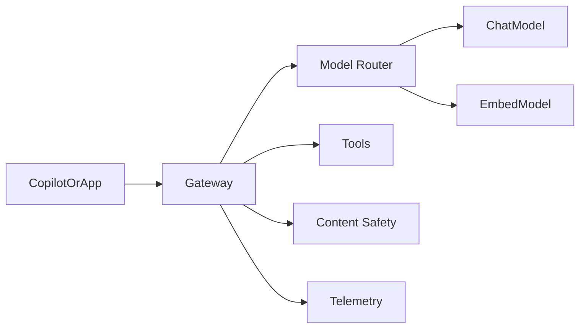

# Azure AI Foundry & Copilot Architecture

Reference architecture for **Microsoft AI ecosystem** patterns: Azure AI / Foundry-style model routing, tool grounding, Copilot extension seams, and enterprise governance controls.

> Cloud-agnostic code with Azure-oriented contracts. No Azure credentials are required to run local stubs.

## Architecture Focus

- Model catalog / deployment routing
- Agent + tool grounding patterns aligned to Foundry-style apps
- Copilot plugin/extension seam (request/response contract)
- Content safety and groundedness hooks
- Configuration via environment, not hardcoded secrets

## High-Level Architecture



## Key Capabilities

| Component | Role |
|---|---|
| Model router | Select deployment by task type and policy |
| Foundry gateway | Unify chat, tools, and safety checks |
| Copilot seam | Canonical invoke contract for extensions |
| Config | Environment-driven endpoints and names |

## Technology Stack

- Python 3.11+
- FastAPI
- Pydantic
- pytest

## Setup

```bash
python -m venv .venv
source .venv/bin/activate  # Windows: .venv\Scripts\activate
pip install -r requirements.txt
cp .env.example .env
pytest
uvicorn src.api:app --reload
```

## Example Usage

```python
from src.gateway.foundry import FoundryGateway

gw = FoundryGateway()
response = gw.chat(
    messages=[{"role": "user", "content": "Draft a change summary"}],
    task="chat",
)
print(response["content"])
```

## Security Considerations

- Use managed identity in Azure; never commit keys
- Apply content safety on ingress/egress
- Separate prod/dev deployments and quotas

## Known Limitations

- Provider calls are stubbed locally
- Copilot integration is contract-level, not a full Teams app

## License

MIT
